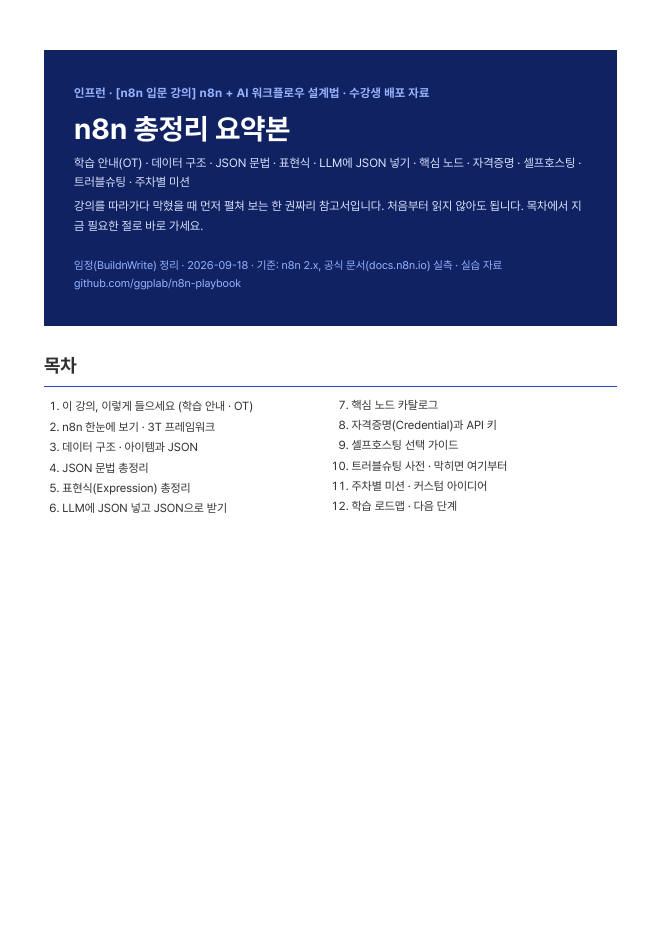
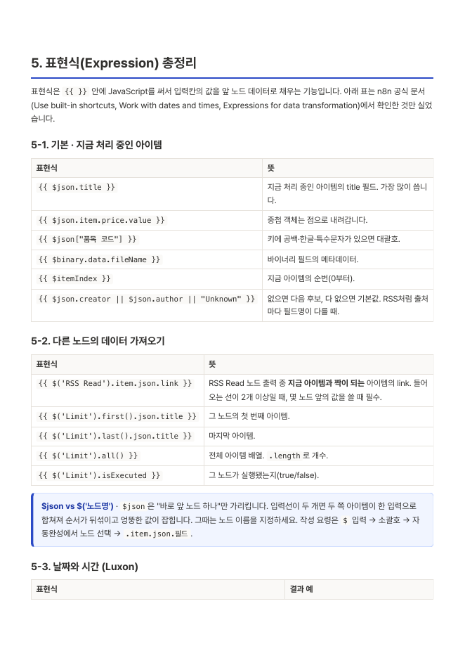
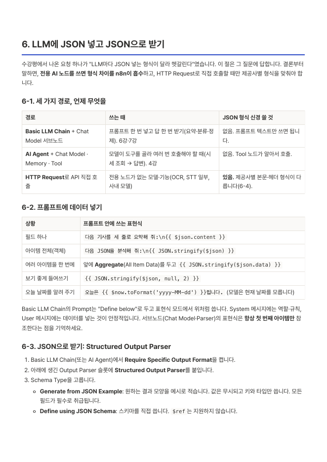
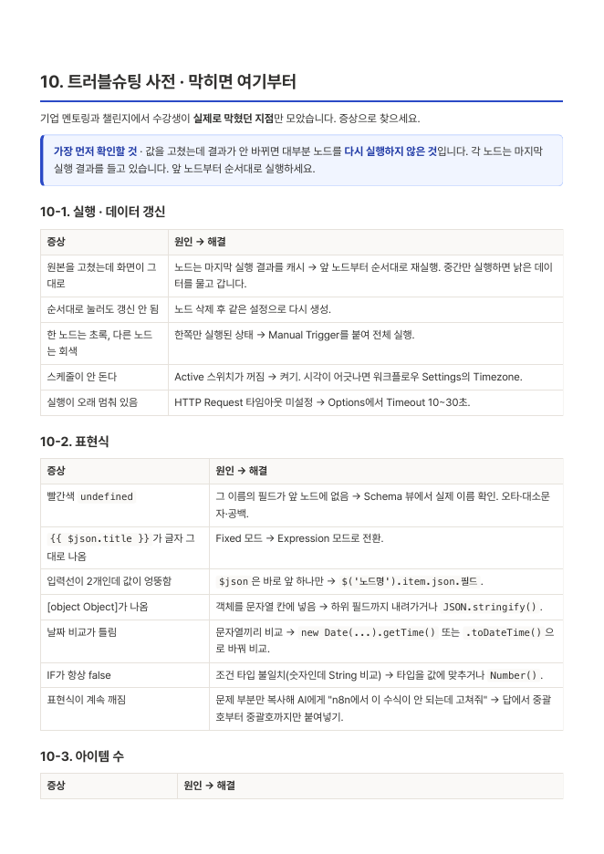

# 05 · n8n 총정리 요약본

인프런 [n8n 입문 강의] 수강생과 『n8n이 다 해줌』 독자를 위한 한 권짜리 참고서입니다. 강의를 따라가다 막혔을 때 먼저 펼쳐 보는 용도로, 처음부터 읽지 않아도 됩니다.

📄 **[n8n-총정리-요약본.pdf](./n8n-총정리-요약본.pdf)** (26쪽, 2026-09-18)

## 담긴 것

| 절 | 내용 |
|---|---|
| 1 | 이 강의, 이렇게 들으세요 (학습 안내 · OT) |
| 2 | n8n 한눈에 보기 · 3T 프레임워크 |
| 3 | 데이터 구조 · 아이템과 JSON |
| 4 | JSON 문법 총정리 |
| 5 | 표현식(Expression) 총정리 — `$json`, `$('노드')`, 날짜, 문자열·배열, Code 노드 차이 |
| 6 | LLM에 JSON 넣고 JSON으로 받기 — Basic LLM Chain, Structured Output Parser, Gemini/OpenAI 형식 차이 |
| 7 | 핵심 노드 카탈로그 |
| 8 | 자격증명(Credential)과 API 키 |
| 9 | 셀프호스팅 선택 가이드 |
| 10 | 트러블슈팅 사전 · 막히면 여기부터 |
| 11 | 주차별 미션 · 커스텀 아이디어 |
| 12 | 학습 로드맵 · 다음 단계 |

## 미리보기

| 표지 · 목차 | 5. 표현식 총정리 |
|---|---|
|  |  |

| 6. LLM에 JSON 넣고 받기 | 10. 트러블슈팅 사전 |
|---|---|
|  |  |

## 함께 보기

- 장별 실습 자료: [01-hanbit-n8n-guidebook](../01-hanbit-n8n-guidebook/)
- 인프런 강의: [n8n 입문 강의 · n8n + AI 워크플로우 설계법](https://www.inflearn.com/course/n8n-introductory-lec)
- 질문: [데이터팝콘 오픈 카톡방](https://open.kakao.com/o/gwBKXcSg)

문법은 n8n 공식 문서(docs.n8n.io) 기준으로 대조했습니다. n8n 화면과 옵션 이름은 버전에 따라 바뀔 수 있습니다.

© 2026 BuildnWrite. All rights reserved.
